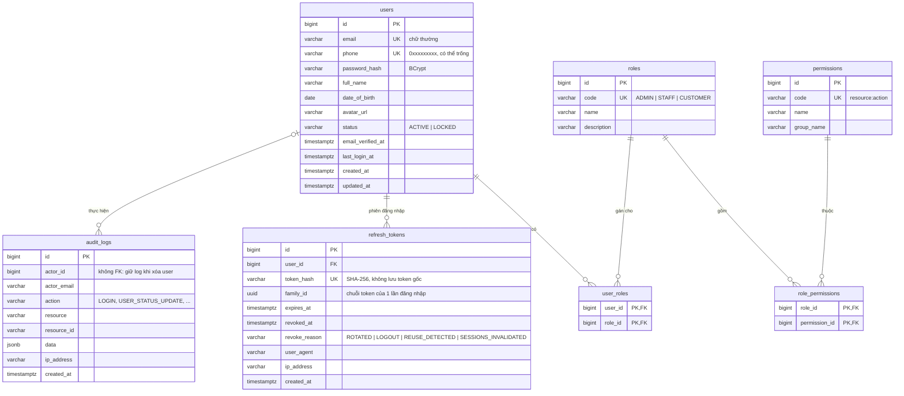
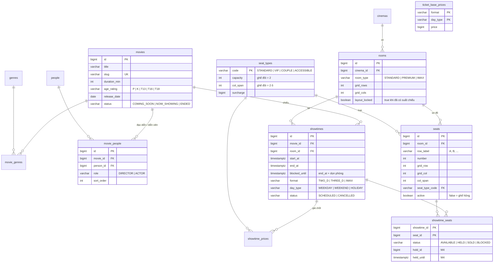
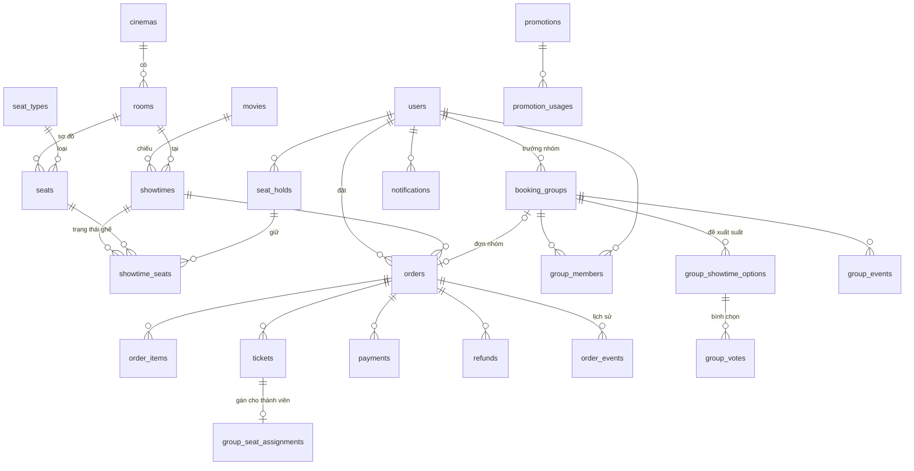

# Sơ đồ thực thể – quan hệ (ERD)

Nguồn sự thật của schema là các migration Flyway trong `backend/api/src/main/resources/db/migration`. Sơ đồ này cập nhật theo từng giai đoạn; bảng đánh dấu ✅ đã có migration, các bảng còn lại là thiết kế theo PLAN.md mục 7.

| Nhóm | Bảng | Trạng thái |
|---|---|---|
| Tài khoản & phân quyền | `users`, `roles`, `permissions`, `user_roles`, `role_permissions`, `refresh_tokens` | ✅ M1 (`V2__auth.sql`) |
| Hệ thống | `audit_logs` | ✅ M1 · `shedlock` ✅ M0 · `system_settings` ✅ M2 |
| Danh mục | `genres`, `people`, `movies`, `movie_genres`, `movie_people` | ✅ M2 (`V3__catalog.sql`) |
| Rạp | `cinemas`, `rooms`, `seat_types`, `seats` | ✅ M2 (`V4__cinema.sql`) |
| Lịch chiếu & giá | `ticket_base_prices`, `holidays`, `showtimes`, `showtime_prices`, `showtime_seats` | ✅ M2 (`V5__showtime.sql`) |
| Bán vé | `seat_holds`, `orders`, `order_items`, `tickets`, `payments`, `refunds`, `order_events` | M4, M7 |
| Nhóm | `booking_groups`, `group_members`, `group_showtime_options`, `group_votes`, `group_seat_assignments`, `group_events`, `seat_suggestion_logs` | M6 |
| Khác | `promotions`, `promotion_usages`, `notifications` | M4, M8 |

## 1. Tài khoản, phân quyền, nhật ký (M1)

## 2. Phim, rạp, lịch chiếu, giá (M2)

Ràng buộc chống trùng lịch: `EXCLUDE USING gist (room_id WITH =, tstzrange(start_at, blocked_until) WITH &&) WHERE status <> 'CANCELLED'`.

## 3. Toàn cảnh nghiệp vụ (thiết kế)

Ràng buộc chống bán trùng ghế (BR01): khóa chính `showtime_seats(showtime_id, seat_id)` + partial unique index `tickets(showtime_id, seat_id) WHERE status <> 'CANCELLED'`.
