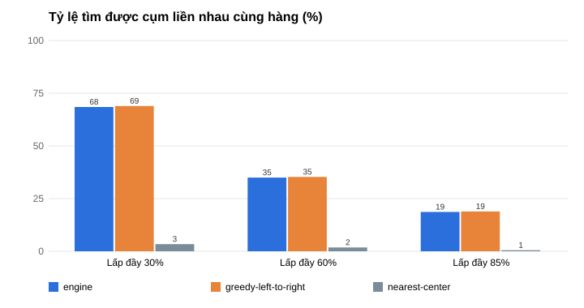
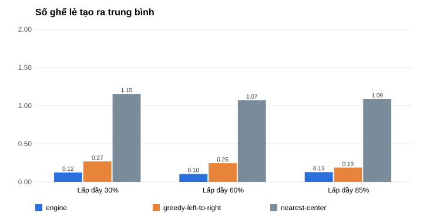
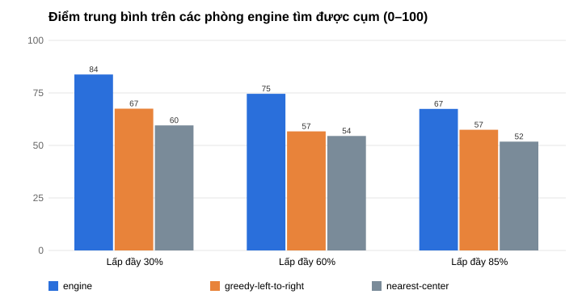

# Thực nghiệm thuật toán đề xuất cụm ghế (M5)

Thuật toán: `backend/seat-engine` (`SeatSuggester`), thiết kế ở PLAN.md mục 8.2.
Mã thực nghiệm: `backend/seat-bench`.

## 1. Thiết lập

| Yếu tố | Giá trị |
|---|---|
| Kích thước phòng | 100 ghế (10 × 10), 200 ghế (10 × 20), 300 ghế (15 × 20); 2 lối đi dọc chia phòng thành 3 khối, khối VIP ở giữa phía sau |
| Tỷ lệ lấp đầy | 30 %, 60 %, 85 % (số ghế đã bán chính xác) |
| Kiểu lấp đầy | `RANDOM`: ghế bán ngẫu nhiên đều · `CENTER`: ghế gần "điểm xem đẹp" bán trước (lấy mẫu có trọng số) |
| Số người n | 2 … 10 |
| Số phòng mỗi tổ hợp | 100 phòng, seed cố định → chạy lại cho cùng kết quả |
| Tổng số lần chạy | 3 × 3 × 2 × 9 × 100 = 16 200 phòng × 3 chiến lược |

**Các chiến lược so sánh**

- `engine`: phương án điểm cao nhất của `SeatSuggester` (tùy chọn mặc định: được chia tối đa 3 hàng liên tiếp).
- `greedy-left-to-right` (baseline 1): duyệt từ hàng đầu, lấy dãy n ghế trống liền nhau đầu tiên; không có thì
  lấy n ghế trống đầu tiên theo thứ tự duyệt.
- `nearest-center` (baseline 2): n ghế trống bất kỳ gần điểm xem đẹp nhất, không quan tâm liền kề.

**Chỉ số**

- `found_rate`: tỷ lệ chọn được ghế. Hai baseline luôn chọn được khi còn đủ ghế (chấp nhận ngồi rời rạc). Engine
  chỉ trả về **cụm** (một hàng, hoặc tối đa 3 hàng liên tiếp chồng cột); không có thì trả lý do `NO_CLUSTER` để
  gợi ý suất khác.
- `same_row_rate`: tỷ lệ cả nhóm ngồi **liền nhau cùng một hàng**.
- `avg_score_common`: điểm trung bình (0–100, cùng một hàm điểm `SeatSuggester.evaluate` cho mọi chiến lược), chỉ
  tính trên các phòng mà engine tìm được cụm, để so sánh trên cùng tập phòng.
- `avg_orphans`: số ghế lẻ (BR14) tạo ra trung bình.
- `avg_fragments`: số cụm rời nhau trung bình (1 = ngồi liền nhau cùng hàng).

## 2. Kết quả chất lượng

Gộp mọi kích thước phòng và n = 2…10 (mỗi dòng 2 700 lần chạy). Chi tiết theo từng tổ hợp:
[`seat-suggestion-detail.csv`](seat-suggestion-detail.csv); bảng tổng hợp:
[`seat-suggestion-summary.csv`](seat-suggestion-summary.csv).

| Lấp đầy | Kiểu | Chiến lược | found | cùng hàng | điểm (cùng tập) | ghế lẻ | số cụm |
|---|---|---|---:|---:|---:|---:|---:|
| 30 % | RANDOM | **engine** | 98,5 % | 71,4 % | **88,6** | **0,12** | **1,33** |
| | | greedy | 100 % | 72,1 % | 69,3 | 0,27 | 1,91 |
| | | nearest-center | 100 % | 5,6 % | 63,4 | 1,19 | 3,65 |
| 30 % | CENTER | **engine** | 94,7 % | 65,4 % | **78,7** | **0,13** | **1,35** |
| | | greedy | 100 % | 65,7 % | 65,6 | 0,27 | 1,61 |
| | | nearest-center | 100 % | 1,2 % | 55,6 | 1,12 | 5,24 |
| 60 % | RANDOM | **engine** | 66,9 % | 36,0 % | **79,4** | **0,19** | **1,66** |
| | | greedy | 100 % | 36,6 % | 61,7 | 0,22 | 3,76 |
| | | nearest-center | 100 % | 3,3 % | 61,7 | 1,12 | 4,55 |
| 60 % | CENTER | **engine** | 85,2 % | 33,9 % | **70,8** | **0,04** | **1,71** |
| | | greedy | 100 % | 33,9 % | 52,7 | 0,27 | 2,77 |
| | | nearest-center | 100 % | 0,3 % | 48,8 | 1,03 | 5,52 |
| 85 % | RANDOM | **engine** | 25,0 % | 13,4 % | **79,3** | **0,10** | **1,59** |
| | | greedy | 100 % | 13,9 % | 65,1 | 0,11 | 5,23 |
| | | nearest-center | 100 % | 0,9 % | 66,6 | 0,33 | 5,40 |
| 85 % | CENTER | **engine** | 60,3 % | 23,9 % | **62,4** | **0,14** | **1,86** |
| | | greedy | 100 % | 23,9 % | 54,3 | 0,27 | 3,22 |
| | | nearest-center | 100 % | 0,1 % | 45,7 | 1,84 | 5,81 |





**Nhận xét**

1. Trên cùng tập phòng, điểm của engine cao hơn baseline tốt nhất **8–20 điểm** ở mọi tỷ lệ lấp đầy. Engine cân
   bằng vị trí trung tâm, ngồi liền nhau và không để ghế lẻ.
2. Ghế lẻ tạo ra ít hơn `greedy` **11–87 %** (đa số tổ hợp khoảng một nửa), và ít hơn `nearest-center`
   **3,5–28 lần**. Chọn gần trung tâm mà bỏ qua liền kề làm phòng bị "thủng lỗ" nặng nhất.
3. Tỷ lệ ngồi cùng hàng của engine **ngang** `greedy` (chênh tối đa 0,7 điểm %). Lý do: khi phương án một hàng duy
   nhất nằm sát màn hình hoặc sát mép, engine có thể ưu tiên chia 2 hàng ở giữa phòng; phương án một hàng vẫn có
   trong top-K để người dùng chọn. Lần chạy đầu với trọng số hàng = 20 cho tỷ lệ này thấp hơn `greedy` 3–5 điểm %,
   nên đã tăng trọng số hàng lên 30 (chia 2 hàng −15 điểm, 3 hàng −30 điểm).
4. Khi phòng gần đầy (85 % ngẫu nhiên), engine chỉ tìm được cụm ở 25 % số phòng, còn baseline vẫn "chọn được"
   nhưng nhóm bị xé thành trung bình hơn 5 cụm. Đây là chủ đích: engine trả `NO_CLUSTER` để hệ thống gợi ý suất
   chiếu khác (GRP14), thay vì xếp nhóm ngồi rải rác.

## 3. Thời gian chạy

Đo bằng JMH (`SuggestBenchmark`, chế độ SampleTime, 3 vòng khởi động + 5 vòng đo × 1 s, 1 fork; mỗi lần gọi dùng
một phòng khác trong 32 phòng sinh sẵn). JDK 17, máy phát triển Windows 11. Dữ liệu:
[`jmh-suggest-300-seats.csv`](jmh-suggest-300-seats.csv).

Phòng **300 ghế** (ms / lần gọi):

| Lấp đầy | n | p50 | p95 | p99 |
|---|---:|---:|---:|---:|
| 30 % | 2 | 0,22 | 0,34 | 0,51 |
| 30 % | 5 | 1,89 | **3,13** | 3,65 |
| 30 % | 10 | 1,05 | 2,08 | 2,75 |
| 60 % | 2 | 0,11 | 0,18 | 0,25 |
| 60 % | 5 | 0,52 | 1,20 | 1,53 |
| 60 % | 10 | 0,09 | 0,40 | 0,54 |
| 85 % | 2 | 0,03 | 0,06 | 0,09 |
| 85 % | 5 | 0,04 | 0,12 | 0,18 |
| 85 % | 10 | 0,01 | 0,02 | 0,04 |

p95 lớn nhất **3,1 ms**, đạt mục tiêu **< 50 ms** (PLAN.md mục 12) với dư địa hơn 15 lần. Phòng càng trống càng
có nhiều cửa sổ ứng viên nên càng chậm; n trung bình (5) chậm nhất vì vừa nhiều cửa sổ một hàng vừa nhiều cách
chia nhiều hàng. Beam search (B = 50) giữ số trạng thái không bùng nổ khi chia 3 hàng.
Đo bằng `System.nanoTime` trong lần chạy thực nghiệm (gộp n = 2…10, 600 lần mỗi n):
[`engine-timing-300-seats.csv`](engine-timing-300-seats.csv), p95 ≤ 3,3 ms.

## 4. Chạy lại

```bash
cd backend
./mvnw -o -pl seat-engine,seat-bench install
# classpath: seat-bench/target/classes; seat-engine/target/classes; jmh-core, jopt-simple, commons-math3 (~/.m2)
java -cp "$CP" com.moviebooking.seatbench.Experiment ../docs/experiments 100
java -cp "$CP" org.openjdk.jmh.Main SuggestBenchmark -p size=S300 -rf csv -rff ../docs/experiments/jmh-suggest-300-seats.csv
```

Trên Windows, phân tách classpath bằng `;`. Kết quả thực nghiệm chất lượng là tất định (seed cố định); số đo
thời gian thay đổi theo máy.
