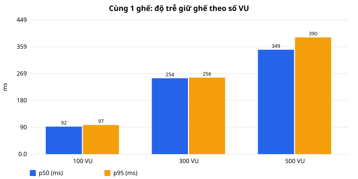
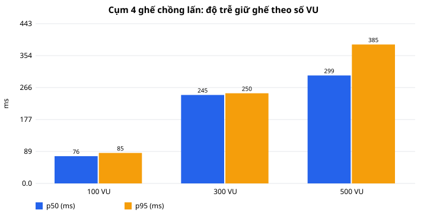
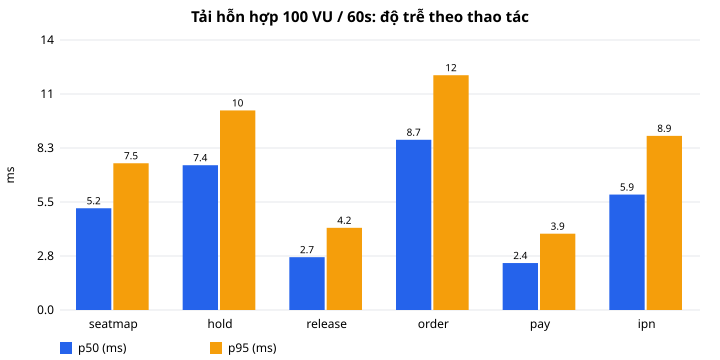

# Kiểm thử đồng thời & hiệu năng (M9)

Mục tiêu (PLAN.md mục 12): **0 lần bán trùng ghế qua mọi kịch bản**; API sơ đồ ghế **p95 < 200 ms**.

## 1. Cách chạy

Kịch bản viết hai bản cùng logic:

| Bản | Tệp | Ghi chú |
|---|---|---|
| k6 | `tools/k6/same-seat.js`, `tools/k6/mixed.js` | Dùng khi máy có k6 (`k6 run ...`, tham số trong đầu tệp) |
| Node 22 | `tools/load/run.mjs` | Không cần cài thêm; tự đăng ký tài khoản, tự chọn suất/ghế, ghi CSV + SVG vào thư mục này |

```bash
node tools/load/run.mjs same-seat    --vus 100,300,500
node tools/load/run.mjs same-cluster --vus 100,300,500
node tools/load/run.mjs seatmap      --vus 50  --duration 30
node tools/load/run.mjs mixed        --vus 100 --duration 60
```

**Môi trường đo**: một máy Windows 11 (12 luồng CPU, 24 GB RAM) chạy cùng lúc backend (Spring Boot, Hikari 10 kết
nối), PostgreSQL nhúng và trình tạo tải — số liệu là cận dưới so với máy chủ thật. Dữ liệu mẫu của môi trường dev.

## 2. Tranh cùng một ghế / cùng một cụm ghế

N người dùng (tài khoản khác nhau) cùng gửi `POST /holds` **tại cùng một thời điểm** (chuẩn bị xong N request rồi
phát đồng thời).

- `same-seat`: tất cả giữ cùng 1 ghế (ghế mép dãy để không vướng quy tắc ghế lẻ).
- `same-cluster`: dãy 8 ghế trống; mỗi người giữ 4 ghế lệch 0 / 2 / 4 → các cụm chồng lấn nhau. Tối đa chỉ 2 cụm
  không giao nhau (lệch 0 và 4) có thể cùng thành công.

Bất biến kiểm tra sau mỗi vòng: không ghế nào thuộc 2 lượt giữ thành công; số ghế `HELD` trên sơ đồ = tổng số ghế
đã giữ (không giữ "một phần" — BR03).

**Cùng 1 ghế** ([same-seat.csv](same-seat.csv))

| VU | Thành công | 409 xung đột | Lỗi khác | Ghế trùng | Sơ đồ khớp | p50 (ms) | p95 (ms) |
|---:|---:|---:|---:|---:|:---:|---:|---:|
| 100 | **1** | 99 | 0 | **0** | ✓ | 92 | 97 |
| 300 | **1** | 299 | 0 | **0** | ✓ | 254 | 256 |
| 500 | **1** | 499 | 0 | **0** | ✓ | 349 | 390 |

**Cụm 4 ghế chồng lấn** ([same-cluster.csv](same-cluster.csv))

| VU | Thành công | 409 xung đột | Lỗi khác | Ghế trùng | Sơ đồ khớp | p50 (ms) | p95 (ms) |
|---:|---:|---:|---:|---:|:---:|---:|---:|
| 100 | **2** | 98 | 0 | **0** | ✓ (8/8) | 76 | 85 |
| 300 | **2** | 298 | 0 | **0** | ✓ (8/8) | 245 | 250 |
| 500 | **2** | 498 | 0 | **0** | ✓ (8/8) | 299 | 385 |

 

Nhận xét: đúng một người thắng mỗi ghế; người thua nhận 409 ngay (không treo, không lỗi 500). Độ trễ tăng gần
tuyến tính theo số VU vì cả N request xếp hàng trên cùng các dòng `showtime_seats` (khóa `FOR UPDATE` theo thứ tự
`seat_id`) và trên pool 10 kết nối — đây là kịch bản xấu nhất, thực tế hiếm khi 500 người bấm cùng một ghế trong
cùng một mili giây.

## 3. API sơ đồ ghế

50 VU gọi liên tục `GET /showtimes/{id}/seats` (không nghỉ) trong 30 s, suất chọn ngẫu nhiên ([seatmap.csv](seatmap.csv)):

| Request | Thông lượng | Lỗi | p50 | p95 | p99 |
|---:|---:|---:|---:|---:|---:|
| 46 641 | 1 555 req/s | 0 | 30,5 ms | **43,1 ms** | 60,5 ms |

→ Đạt mục tiêu p95 < 200 ms ngay cả khi bão hòa CPU máy đo.

## 4. Tải hỗn hợp

100 VU trong 60 s, mỗi VU nghỉ 0,5–1,5 s giữa các lượt (giống người dùng thật và nằm dưới giới hạn 20 lượt giữ /
phút / người — BR15). Mỗi lượt: xem sơ đồ ghế; 30 % tiếp tục giữ 2 ghế ở mép 3 đoạn trống dài nhất (nhiều VU nhắm
cùng ghế → có tranh chấp thật), trong đó 1/3 tạo đơn → thanh toán cổng giả lập → IPN, phần còn lại trả ghế.
8 suất còn nhiều ghế nhất được dùng chung.

[mixed.csv](mixed.csv) · [mixed-summary.csv](mixed-summary.csv)

| Thao tác | Số lần | p50 (ms) | p95 (ms) | p99 (ms) | max (ms) |
|---|---:|---:|---:|---:|---:|
| Xem sơ đồ ghế | 5 957 | 5,2 | **7,5** | 8,9 | 31,5 |
| Giữ ghế | 1 797 | 7,4 | 10,2 | 12,0 | 19,7 |
| Trả ghế | 1 185 | 2,7 | 4,2 | 5,4 | 10,9 |
| Tạo đơn | 601 | 8,7 | 12,0 | 14,5 | 17,6 |
| Tạo phiên thanh toán | 601 | 2,4 | 3,9 | 4,7 | 5,5 |
| IPN | 601 | 5,9 | 8,9 | 11,2 | 12,8 |

Tổng 10 742 request (179 req/s): giữ ghế thành công 1 786, xung đột 409: 11, **601 đơn PAID, 0 lỗi, 0 ghế bán trùng**.



## 5. Lỗi phát hiện nhờ kiểm thử tải và đã sửa

1. **Cạn pool kết nối khi đăng ký đồng thời** (16 request `POST /auth/register` song song → treo 30 s rồi lỗi 500
   `Connection is not available`). Nguyên nhân: ghi nhật ký kiểm toán dùng `REQUIRES_NEW` — mỗi request giữ kết nối
   của transaction nghiệp vụ và xin thêm kết nối thứ hai; ≥ 10 request cùng lúc (pool 10) chờ lẫn nhau. Tương tự với
   thông báo ghi trong pha `AFTER_COMMIT` (kết nối cũ vẫn bị giữ tới khi kết thúc transaction).
   Sửa: nhật ký ghi trong transaction hiện tại (`REQUIRED`; đăng nhập thất bại và phát hiện dùng lại refresh token
   dùng `noRollbackFor = BusinessException` để vẫn lưu); listener thông báo chạy `@Async`.
2. **`@Async` không có pool giới hạn**: cấu hình STOMP tạo sẵn executor riêng nên Spring Boot bỏ qua
   `applicationTaskExecutor`, `@Async` rơi về `SimpleAsyncTaskExecutor` (mỗi tác vụ một luồng mới). Sửa: `AsyncConfig`
   khai báo executor theo `spring.task.execution.*` (4–16 luồng).
