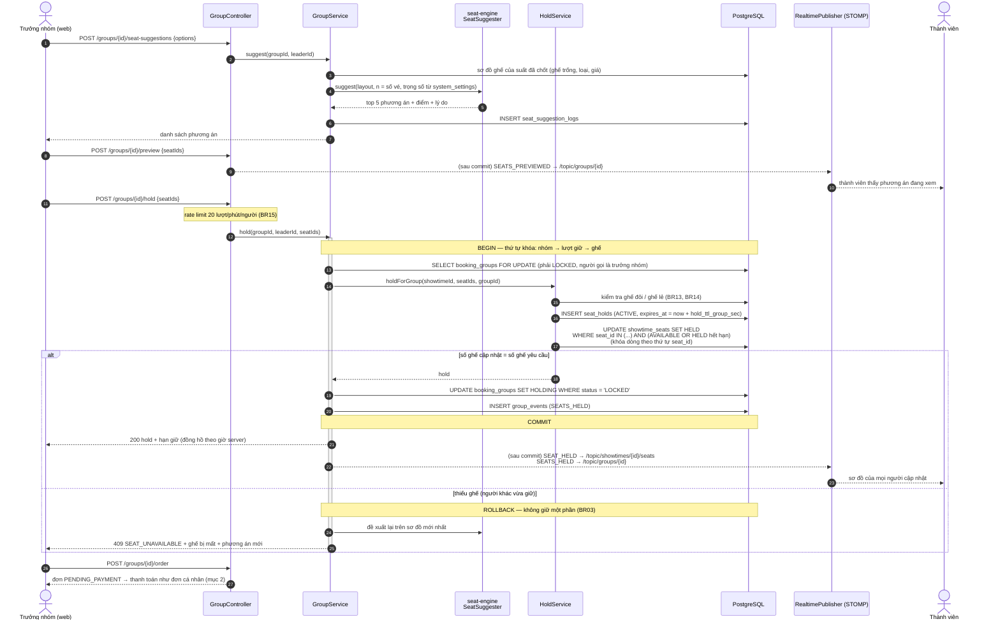

# Sơ đồ tuần tự

Ba luồng có xử lý đồng thời quan trọng nhất (PLAN.md mục 8). Quy ước: mọi chuyển trạng thái là
`UPDATE ... WHERE status = <cũ>`; sự kiện realtime/thông báo chỉ phát **sau commit**.

## 1. Giữ ghế cho nhóm (GRP10–GRP14)

Trưởng nhóm đã chốt suất (`LOCKED`). Toàn bộ cụm ghế được giữ trong **một transaction**: thiếu một ghế là rollback
cả cụm và trả về phương án mới ngay (GRP14).



## 2. Thanh toán & IPN (BKG06, BR05, BR17)

IPN là nguồn sự thật; trang return chỉ để hiển thị. Callback trùng không đổi trạng thái lần hai.

```mermaid
sequenceDiagram
    autonumber
    actor U as Người dùng
    participant W as Web
    participant PC as PaymentController
    participant PS as PaymentService
    participant P as PaymentProvider<br/>(MOCK / VNPAY)
    participant OS as OrderService
    participant DB as PostgreSQL
    participant L as Listener AFTER_COMMIT (@Async)

    U->>W: Thanh toán
    W->>PC: POST /orders/{code}/pay {provider}
    PC->>PS: initiate(userId, code, provider, ip)
    PS->>DB: đơn của chính user, PENDING_PAYMENT, ghế còn giữ
    PS->>P: createPayment(order) — số tiền lấy từ DB
    P-->>W: redirectUrl (cổng giả lập / VNPay)
    U->>P: thanh toán trên cổng
    P->>PC: IPN (POST /payments/MOCK/ipn | GET /payments/VNPAY/ipn)
    PC->>PS: handleCallback(params)
    PS->>P: verifyCallback — kiểm chữ ký HMAC
    alt chữ ký sai
        PS-->>P: từ chối (VNPay: RspCode 97)
    else hợp lệ
        Note over PS,DB: BEGIN
        PS->>DB: INSERT payments ... ON CONFLICT (provider, provider_txn_id) DO NOTHING
        alt giao dịch đã xử lý (callback trùng)
            PS-->>P: kết quả cũ (idempotent)
        else số tiền khác tổng đơn
            PS->>DB: payments.status = AMOUNT_MISMATCH, đơn giữ nguyên (đối soát tay)
        else lần đầu, đúng số tiền
            PS->>OS: markPaid(order)
            OS->>DB: UPDATE orders SET PAID WHERE status = 'PENDING_PAYMENT'
            OS->>DB: UPDATE showtime_seats SET SOLD WHERE hold_id = ? AND status = 'HELD'
            alt đủ ghế
                OS->>DB: INSERT tickets (QR ký HMAC), order_events; nhóm → BOOKED + phân phối vé
            else lượt giữ đã hết hạn
                OS->>DB: thử giữ lại đúng các ghế đó (BR17)
                alt giữ lại được
                    OS->>DB: SOLD + tickets
                else ghế đã bán cho người khác
                    OS->>DB: orders → REFUND_PENDING + refunds (PENDING)
                end
            end
            Note over PS,DB: COMMIT
            PS-->>P: OK (VNPay: RspCode 00)
            PS-->>L: OrderStatusChangedEvent
            L->>L: thông báo in-app, email vé, realtime SEAT_SOLD / PAID
        end
    end
    P-->>W: chuyển về /orders/{code} (trang return)
    W->>PC: GET /orders/{code} → hiển thị vé QR
```

## 3. Hết hạn giữ ghế (BR02)

Hai lớp: *lazy* (mọi truy vấn coi `HELD` quá `held_until` là trống, nên ghế mở bán lại ngay cả khi job chưa chạy) và
*chủ động* (`HoldExpiryJob` mỗi 10 giây dọn dẹp và báo cho người dùng).

```mermaid
sequenceDiagram
    autonumber
    participant J as HoldExpiryJob (@Scheduled 10 s)
    participant HS as HoldService
    participant DB as PostgreSQL
    participant GL as GroupEventListener (đồng bộ, trong transaction)
    participant L as Listener AFTER_COMMIT
    actor U as Người giữ ghế / thành viên nhóm
    actor O as Người xem sơ đồ

    J->>HS: findDueIds(200)
    HS->>DB: id các seat_holds ACTIVE AND expires_at < now (tối đa 200)
    loop từng lượt giữ — expire(holdId), transaction riêng
        Note over HS,DB: BEGIN
        HS->>DB: UPDATE seat_holds SET EXPIRED WHERE status = 'ACTIVE'
        alt lượt giữ vừa được thanh toán / trả (0 dòng)
            HS-->>J: bỏ qua
        else
            HS->>DB: UPDATE showtime_seats SET AVAILABLE WHERE hold_id = ? AND status = 'HELD'
            HS->>DB: UPDATE orders SET EXPIRED WHERE status = 'PENDING_PAYMENT'
            HS->>DB: trả lượt dùng mã giảm giá
            HS-->>GL: HoldClosedEvent (nếu là lượt giữ nhóm)
            GL->>DB: UPDATE booking_groups SET LOCKED WHERE status = 'HOLDING'
            Note over HS,DB: COMMIT (lỗi khóa → thử lại ở lượt sau)
            HS-->>L: SEAT_RELEASED, OrderStatusChangedEvent(EXPIRED), GroupChanged
            L-->>O: sơ đồ ghế cập nhật realtime
            L-->>U: thông báo "Đơn hàng đã hết hạn"; nhóm quay về chọn ghế
        end
    end
```

Nếu tiền về **sau** khi lượt giữ đã hết hạn → nhánh BR17 ở mục 2.
