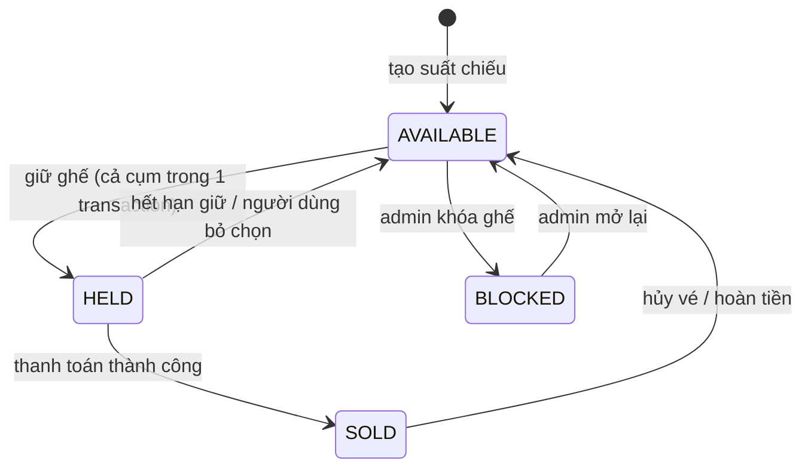
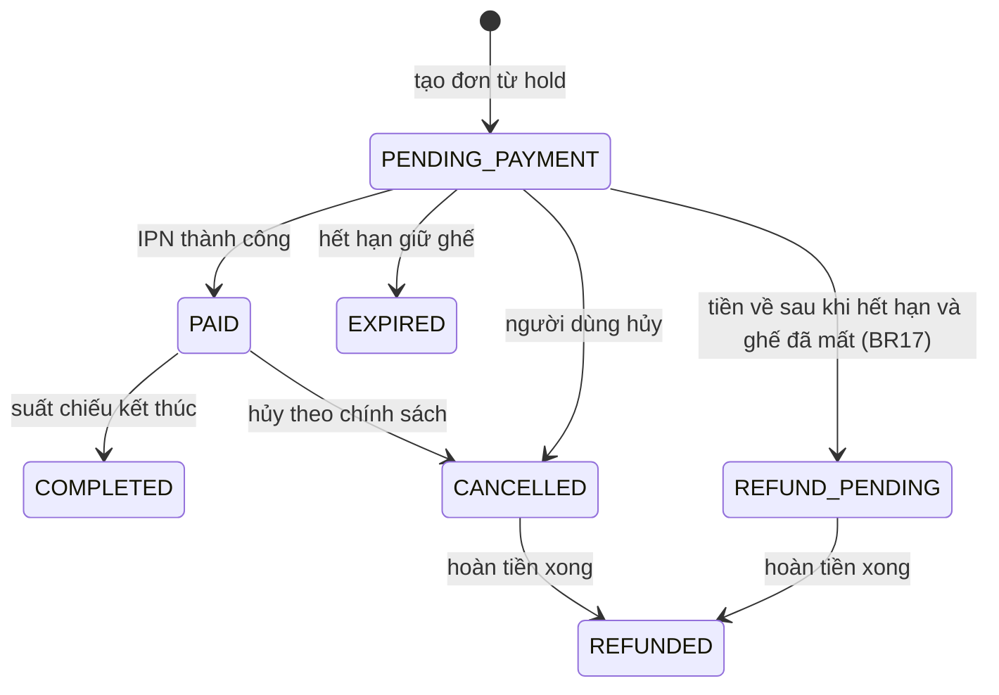
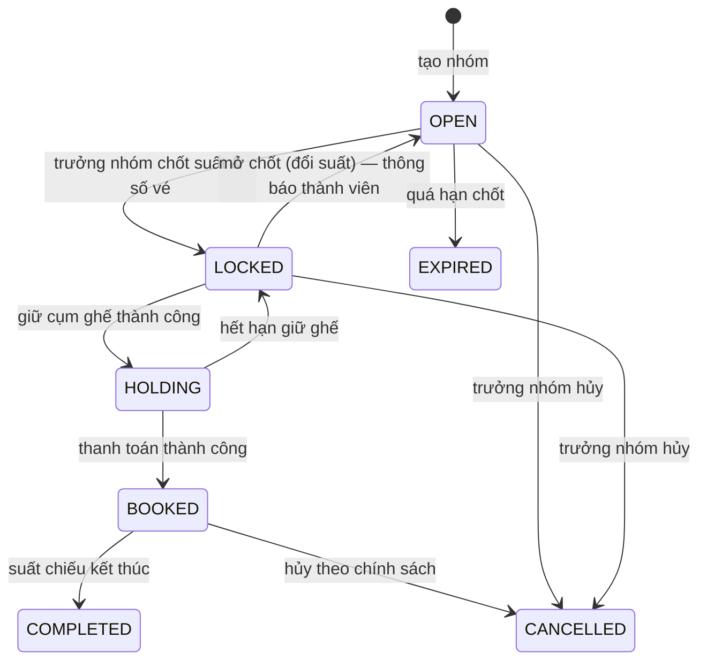
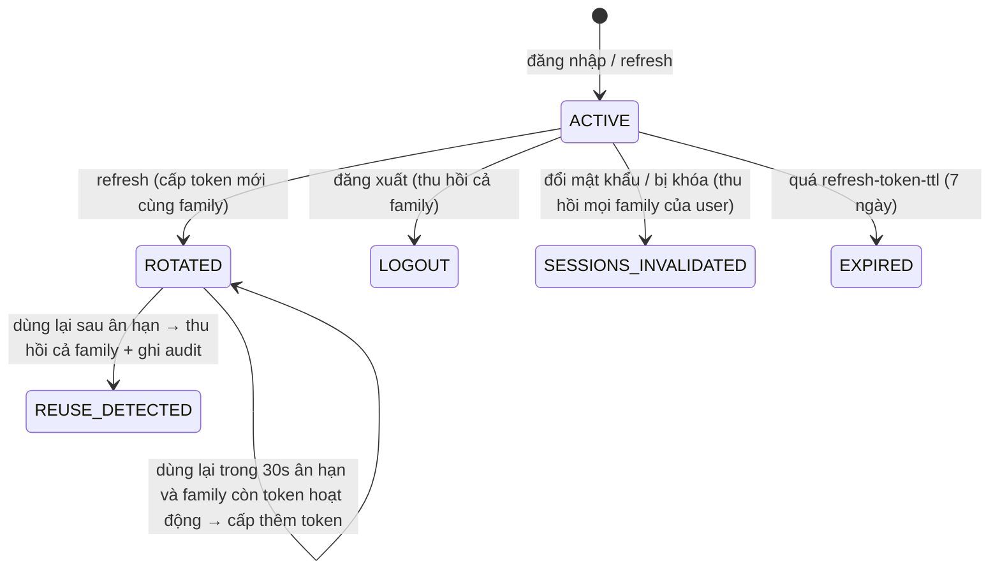

# Máy trạng thái

Mọi chuyển trạng thái được thực hiện bằng câu lệnh có điều kiện `UPDATE ... WHERE status = <trạng thái cũ>` và kiểm tra số dòng bị ảnh hưởng, để hai request đồng thời không cùng chuyển một bản ghi (PLAN.md mục 6).

## 1. Ghế theo suất chiếu — `showtime_seats.status` (M4)

`HELD` mà `held_until < now()` được coi là trống ngay cả khi job dọn dẹp chưa chạy (BR02).

## 2. Đơn hàng — `orders.status` (M4, M7)

## 3. Nhóm đặt vé — `booking_groups.status` (M6)

## 4. Refresh token — `refresh_tokens` (M1, đã triển khai)

Mỗi lần đăng nhập tạo một *family*. Mỗi lần refresh, token cũ bị thu hồi (`ROTATED`) và token mới cùng family được cấp.

Thời gian ân hạn (`app.security.refresh-token-reuse-grace`) tránh đăng xuất nhầm khi nhiều tab cùng refresh một lúc; ngoài khoảng đó, token đã xoay vòng bị dùng lại được coi là bị đánh cắp.
