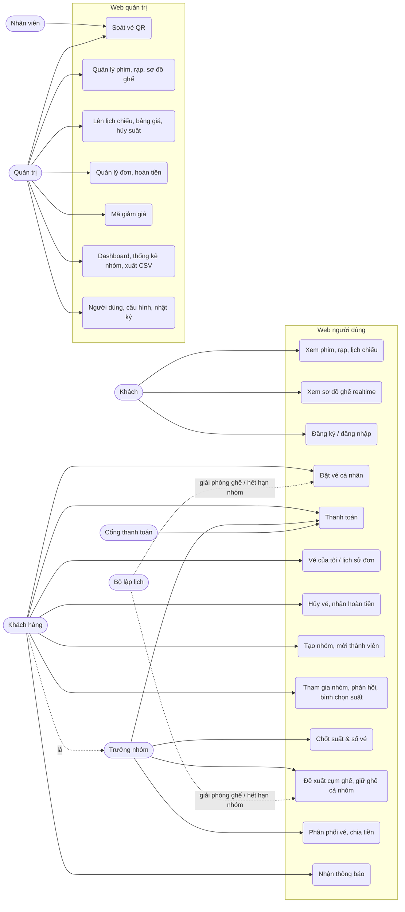

# Use case

Danh sách chức năng đầy đủ kèm mã và độ ưu tiên: PLAN.md mục 4. Tài liệu này gom chúng theo tác nhân và mô tả chi
tiết ba use case trọng tâm.

## 1. Tác nhân

| Tác nhân | Mô tả |
|---|---|
| Khách | Chưa đăng nhập: xem phim, rạp, lịch chiếu, sơ đồ ghế |
| Khách hàng (CUSTOMER) | Đặt vé cá nhân, tạo/tham gia nhóm, xem vé, hủy vé |
| Trưởng nhóm | Vai trò **trong một nhóm** của khách hàng: chốt suất, chọn & giữ ghế, thanh toán cho cả nhóm |
| Nhân viên (STAFF) | Soát vé tại rạp |
| Quản trị (ADMIN) | Danh mục, rạp & sơ đồ ghế, suất chiếu, giá, đơn hàng, hoàn tiền, mã giảm giá, cấu hình, báo cáo |
| Cổng thanh toán | Hệ thống ngoài (giả lập / VNPay) gửi kết quả thanh toán (IPN) |
| Bộ lập lịch | Tác nhân hệ thống: giải phóng ghế hết hạn, hết hạn nhóm, hoàn tất đơn sau suất chiếu |

## 2. Sơ đồ tổng quan

## 3. Bảng use case ↔ chức năng

| Use case | Chức năng (PLAN.md mục 4) | Trạng thái |
|---|---|---|
| Xem phim, rạp, lịch chiếu | MOV01–03, SCH01–03 | ✅ |
| Xem sơ đồ ghế realtime | BKG01 | ✅ |
| Đăng ký / đăng nhập / hồ sơ | USR01, 02, 05, 06 | ✅ (USR03–04 xác thực email, quên mật khẩu: chưa làm) |
| Đặt vé cá nhân | BKG02–05, BKG07–08 | ✅ |
| Thanh toán | BKG06 (giả lập, VNPay) | ✅ (VNPay chưa chạy sandbox thật) |
| Vé của tôi / lịch sử đơn | BKG09 | ✅ |
| Hủy vé, hoàn tiền | BKG10, GRP21, ORDADM-R | ✅ |
| Nhóm: tạo, mời, tham gia, rời, chuyển trưởng nhóm | GRP01–04, GRP20 | ✅ |
| Nhóm: phản hồi, bình chọn, tổng hợp, cảnh báo | GRP05–08, GRP19 | ✅ |
| Nhóm: chốt, chọn ghế, giữ ghế nguyên khối | GRP09–15 | ✅ |
| Nhóm: thanh toán, phân phối vé, chia tiền | GRP16–17 | ✅ |
| Thông báo in-app + email | NOT01, GRP18, BKG08 | ✅ |
| Soát vé | CHK01 | ✅ |
| Quản trị danh mục, rạp, lịch chiếu, giá | MOVADM, CIN01–02, SCHADM01–04 | ✅ |
| Quản trị đơn, nhóm, khuyến mãi, người dùng, cấu hình, nhật ký | ORDADM, GRPADM, PROADM, USRADM, SYS01–02 | ✅ |
| Báo cáo | ADM01–03 | ✅ |

## 4. Đặc tả use case trọng tâm

### UC-04 Đặt vé cá nhân

| | |
|---|---|
| Tác nhân | Khách hàng |
| Tiền điều kiện | Đã đăng nhập; suất chiếu còn bán (chưa bắt đầu, chưa hủy) |
| Hậu điều kiện | Đơn `PAID`, ghế `SOLD`, vé QR trong "Vé của tôi", có thông báo + email |

**Luồng chính**
1. Chọn phim → ngày → suất; hệ thống hiển thị sơ đồ ghế (cập nhật realtime).
2. Chọn ghế (tối đa `max_seats_per_booking`); hệ thống kiểm tra ghế đôi và ghế lẻ (BR13, BR14).
3. Bấm "Tiếp tục": hệ thống giữ ghế trong một transaction (tất cả hoặc không), tạo đơn `PENDING_PAYMENT`, hiển thị
   đồng hồ theo hạn giữ của server.
4. (Tùy chọn) nhập mã giảm giá.
5. Chọn cổng thanh toán, thanh toán; cổng gửi IPN → đơn `PAID`, tạo vé có QR ký HMAC.
6. Hệ thống hiển thị vé, gửi thông báo + email.

**Luồng thay thế**
- 3a. Ghế vừa bị người khác giữ → 409, sơ đồ tô lại, người dùng chọn ghế khác.
- 3b. Quá 20 lượt giữ/phút → 429 (BR15).
- 5a. Hết hạn giữ trước khi trả tiền → đơn `EXPIRED`, ghế mở bán lại; nếu tiền vẫn về sau đó: giữ lại được ghế thì
  vẫn bán, không được thì `REFUND_PENDING` (BR17).
- 5b. Callback trùng → kết quả không đổi (BR05).

### UC-11 Giữ ghế cho nhóm

| | |
|---|---|
| Tác nhân | Trưởng nhóm |
| Tiền điều kiện | Nhóm `LOCKED` (đã chốt suất và số vé n) |
| Hậu điều kiện | Nhóm `HOLDING`, n ghế `HELD` cho nhóm, mọi thành viên thấy ghế đã giữ |

**Luồng chính**
1. Mở "Chọn ghế cho nhóm": hệ thống gọi seat-engine, trả 3–5 phương án có điểm (trung tâm, số hàng, thẳng cột,
   ghế lẻ còn lại, giá, lãng phí) và lý do.
2. Trưởng nhóm xem trước phương án trên sơ đồ (thành viên thấy realtime), có thể đổi tùy chọn (cho phép chia hàng,
   loại ghế, giá tối đa) hoặc chỉnh tay — hệ thống chấm điểm lựa chọn tay.
3. Bấm "Giữ ghế & thanh toán": giữ nguyên khối trong một transaction, tạo đơn nhóm, chuyển sang thanh toán (UC-04
   bước 5). Thanh toán xong: nhóm `BOOKED`, vé tự phân phối cho thành viên (trưởng nhóm sửa được), hiển thị chia tiền.

**Luồng thay thế**
- 1a. Không còn cụm phù hợp → lý do `NOT_ENOUGH_SEATS` / `NO_CLUSTER`, gợi ý mở chốt để chọn suất khác.
- 3a. Một ghế trong cụm vừa bị giữ → rollback cả cụm, 409 kèm phương án mới ngay (GRP14).
- 3b. Hết hạn giữ (`hold_ttl_group_sec`) chưa thanh toán → nhóm về `LOCKED`, thành viên được thông báo.

### UC-A1 Soát vé

| | |
|---|---|
| Tác nhân | Nhân viên |
| Tiền điều kiện | Có quyền `ticket:checkin`; suất chiếu trong khung soát vé (mở trước 120 phút, đến khi suất kết thúc) |
| Hậu điều kiện | Vé `USED`, ghi thời điểm + người soát |

**Luồng chính**
1. Mở trang soát vé (điện thoại), quét QR bằng camera hoặc nhập mã.
2. Hệ thống kiểm chữ ký QR, đúng suất / khung giờ, đơn đã thanh toán; chuyển vé `VALID → USED`.
3. Hiển thị kết quả lớn, rõ (xanh: hợp lệ, số vé đã soát; đỏ: lý do).

**Luồng thay thế**
- 1a. QR của cả đơn (đơn nhóm) → soát mọi vé còn hiệu lực của đơn.
- 2a. Chữ ký sai → "QR không hợp lệ"; vé đã soát → "đã được soát lúc …"; vé đã hủy / ngoài khung giờ → từ chối kèm
  lý do.
